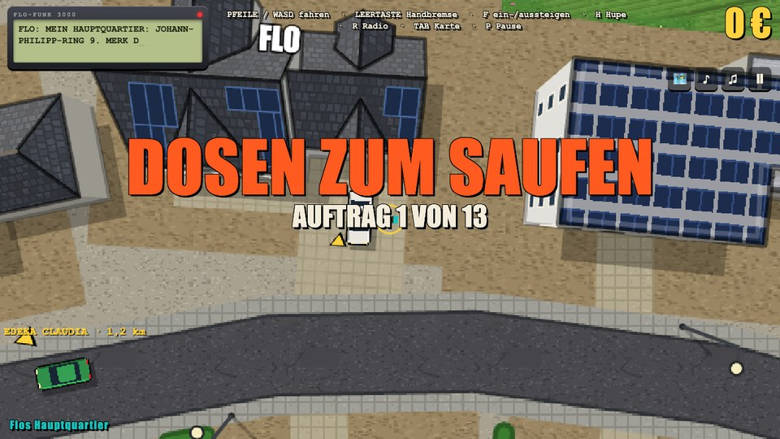
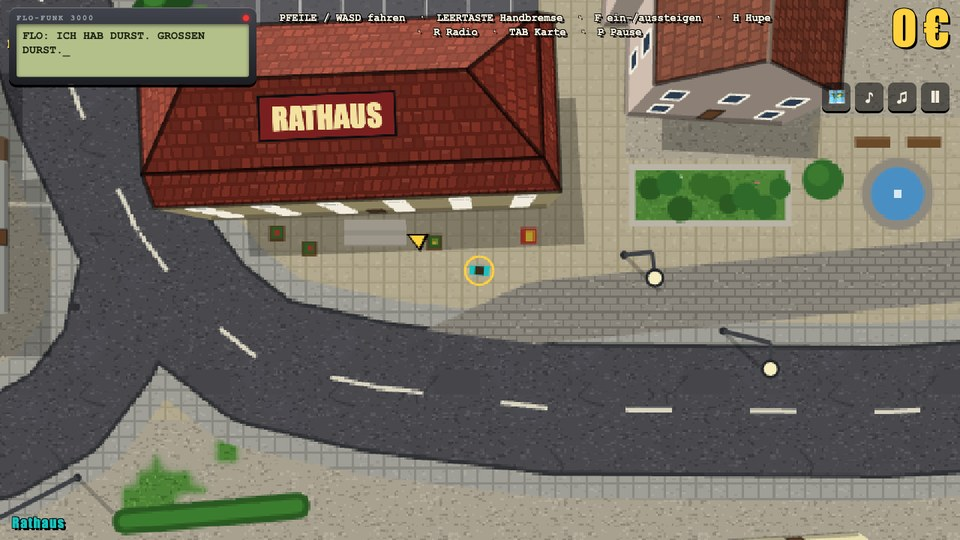
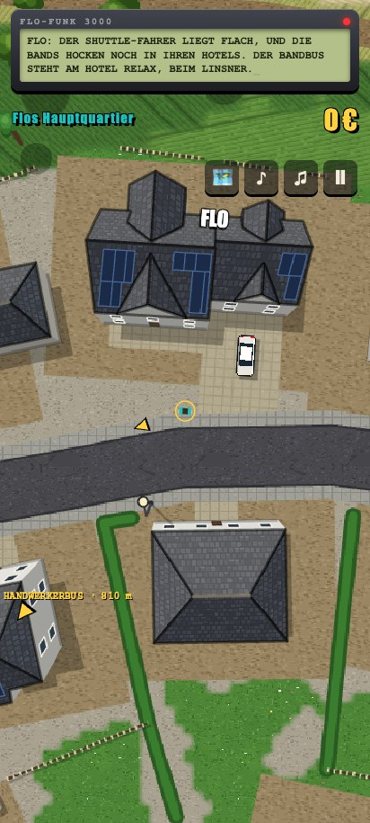

# Grand Theft Wachenroth

A top-down crime caper set in Wachenroth, a market village of about 2,000
people in the Steigerwald in Upper Franconia. You drive, steal and deliver your
way through thirteen jobs, and a man called Flo tells you what to do over a
pager.

**Play it in the browser:** https://schinken.github.io/grand-theft-wachenroth/
It runs on a phone too. The game speaks German.


## The story

Flo runs his business from Johann-Philipp-Ring 9. Nobody quite knows what the
business is, but the village keeps running out of things, and Flo always knows
somebody who can fix that. That somebody is you.



His pager, the FLO-FUNK 3000, beeps, mumbles and spells out the next job. It
starts small and gets bigger:

| #   | Job                      | What Flo wants                                                        |
| --- | ------------------------ | --------------------------------------------------------------------- |
| 1   | Dosen zum Saufen         | Five cans of Jacky Cola from Edeka Claudia. He is thirsty.            |
| 2   | Brotzeit für den SV      | Food from Edeka Claudia and the butcher to the sports club.           |
| 3   | Pizza-Express            | The pizza driver of La Vite is ill. Four deliveries, tips for speed.  |
| 4   | Stillstand ist Rückstand | A concrete mixer from Röckelein for the roadworks in Schulstraße.     |
| 5   | Weizen für den Bäck      | No flour, no rolls: the wheat tractor from the Lagerhaus to the Bäck. |
| 6   | Bier für den Schwallclub | The beer has run out. Every bump costs a bottle.                      |
| 7   | Feiner Zwirn             | A suit for the Kerwa, from Murk. The police want it back.             |
| 8   | Johannifeuer             | The midsummer bonfire is out of control: borrow the fire engine.      |
| 9   | Aischgründer Gold        | The Grüner Baum has run out of carp. Go fishing.                      |
| 10  | Der Baam                 | Lads from Höchstadt stole the maypole. Ram their tractor.             |
| 11  | Kerwa ausgraben          | Three barrels hidden in the village, and the clock is ticking.        |
| 12  | Koppel of Rock           | Drive the bands from their hotels to the festival meadow.             |
| 13  | Kerwa-Samstag            | Flo, the brass band and the police, all on the way to the tent.       |

The Kerwa is the village fair, the biggest weekend of the year.



Along the way you pick up police stars (the car wash at Murk makes you clean
again), lose money in the hospital at Höchstadt, and climb from _Dorfdepp_ to
_Pate von Wachenroth_. Once a day a slow goods train with coils of steel rolls
through, and the level crossings shut for it.


## A parody

This is an unofficial parody, made by and for people from Wachenroth. The title
and the look poke fun at the top-down crime games of the late 1990s; the
graphics, sounds and music are all made for this game.

All stories are made up. The places are real and so are a few names, but
nobody at Röckelein, Murk, Edeka Claudia, La Vite, the Bäck or the Schwallclub
has ever lost a concrete mixer, a suit, a sandwich or a crate of beer to Flo.
At least not that we know of.

## Playing

| Keyboard       | Phone       | Does               |
| -------------- | ----------- | ------------------ |
| Arrows or WASD | Thumb stick | Drive or walk      |
| Space          | BREMSE      | Handbrake          |
| F or Enter     | EIN/AUS     | Get in or out      |
| H              | HUPE        | Horn               |
| Tab            | Map button  | Map of the village |
| R, M           | ♪ and ♫     | Radio, sound       |
| P or Esc       | II          | Pause              |

The game saves after every job.




## The map is real

The village is built from open data:

- **Roads, places, water:** OpenStreetMap.
- **Buildings:** the 3D building model of the Bavarian surveying office, with
  measured heights, roof shapes, ridge directions and towers.
- **Trees:** the same office's survey of single trees, about 7,000 of them.
- **Roof colours, yards and fields:** read off the aerial photo.
- **Fences and hedges:** along the parcel borders of the cadastre.

A few buildings that matter to the story are modelled by hand: Flo's house, the
town hall with its square, and a house with its garden.

Map data © OpenStreetMap contributors, ODbL. Buildings, trees, aerial photo and
parcels: Bayerische Vermessungsverwaltung – www.geodaten.bayern.de, CC BY 4.0,
simplified.

## Under the hood

Plain JavaScript modules and an HTML canvas, no framework. All sound and music
is synthesised in the browser.

```sh
npm ci
npm run check   # Prettier and ESLint (Google JavaScript style)
npm run build   # bundles the game into _site/
```

To play locally, serve the folder with any static web server and open
`index.html`. Add `?selftest` to run the built-in checks: the page title turns
into `selftest ok`.

- `game.js`: the game. `missions.js`: Flo's jobs and lines. `audio.js`: sound.
- `map.js` is generated. `tools/osm2map.py` bakes it from an OpenStreetMap
  extract and the open data files listed at the top of the script.
- `tools/playtest.js` is a bot that plays all jobs through the thumb stick, and
  `tools/perf.js` measures frame times; both run in Playwright.

Every push to `master` is checked, built and deployed to GitHub Pages.
