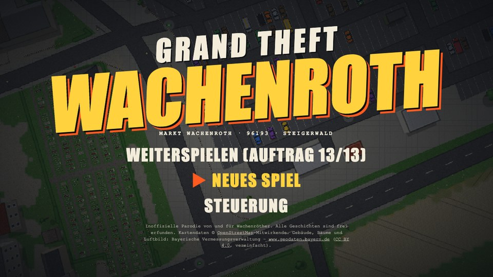
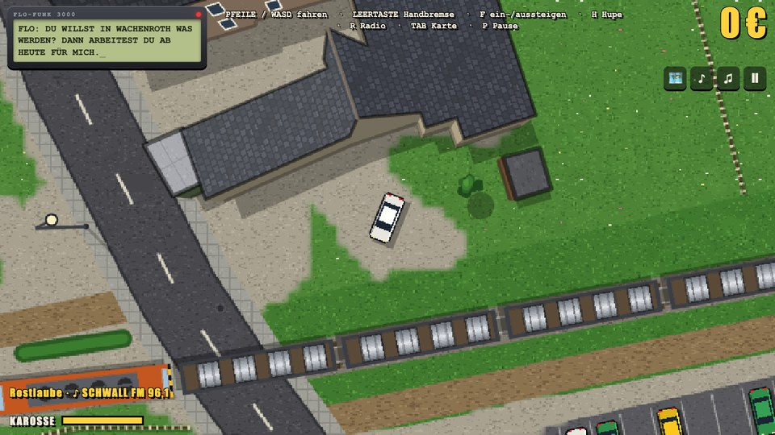
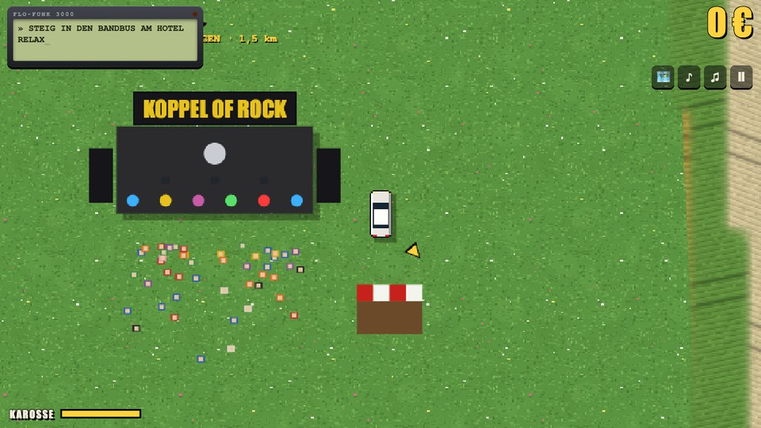
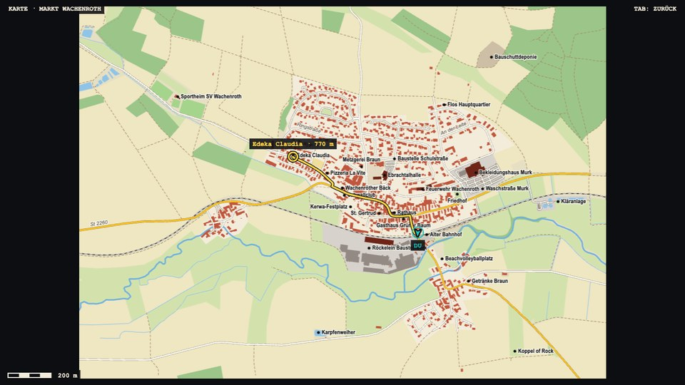

# Grand Theft Wachenroth

A top-down crime caper set in Wachenroth, a market village of about 2,000
people in the Steigerwald in Upper Franconia. You drive, steal and deliver your
way through twenty-two jobs, and a man called Flo tells you what to do over a
pager.

**Play it in the browser:** https://schinken.github.io/grand-theft-wachenroth/
It runs on a phone too. The game speaks German.



## The story

Flo runs his business from Johann-Philipp-Ring 9. Nobody quite knows what the
business is, but the village keeps running out of things, and Flo always knows
somebody who can fix that. That somebody is you.


His pager, the FLO-FUNK 3000, beeps, mumbles and spells out the next job. It
starts small and gets bigger:

| #   | Job                                                                                               | What Flo wants                                                                                                                                                      |
| --- | ------------------------------------------------------------------------------------------------- | ------------------------------------------------------------------------------------------------------------------------------------------------------------------- |
| 1   | [Dosen zum Saufen](https://schinken.github.io/grand-theft-wachenroth/?job=cans)                   | Five cans of Jacky Cola from Edeka Claudia. He is thirsty.                                                                                                          |
| 2   | [Brotzeit für den SV](https://schinken.github.io/grand-theft-wachenroth/?job=snack)               | Food from Edeka Claudia and the butcher to the sports club.                                                                                                         |
| 3   | [Pizza-Express](https://schinken.github.io/grand-theft-wachenroth/?job=pizza)                     | The pizza driver of La Vite is ill. Four deliveries, tips for speed.                                                                                                |
| 4   | [Stillstand ist Rückstand](https://schinken.github.io/grand-theft-wachenroth/?job=concrete)       | A concrete mixer from Röckelein for the roadworks in Schulstraße.                                                                                                   |
| 5   | [Weizen für den Bäck](https://schinken.github.io/grand-theft-wachenroth/?job=wheat)               | No flour, no rolls: the wheat tractor from the Lagerhaus to the Bäck.                                                                                               |
| 6   | [Bier für den Schwallclub](https://schinken.github.io/grand-theft-wachenroth/?job=beer)           | The beer has run out. Every bump costs a bottle.                                                                                                                    |
| 7   | [Feiner Zwirn](https://schinken.github.io/grand-theft-wachenroth/?job=suit)                       | A suit for the Kerwa, from Murk. The police want it back.                                                                                                           |
| 8   | [Johannifeuer](https://schinken.github.io/grand-theft-wachenroth/?job=fire)                       | The midsummer bonfire is out of control: borrow the fire engine.                                                                                                    |
| 9   | [Aischgründer Gold](https://schinken.github.io/grand-theft-wachenroth/?job=carp)                  | The Grüner Baum has run out of carp. Go fishing.                                                                                                                    |
| 10  | [K1](https://schinken.github.io/grand-theft-wachenroth/?job=k1)                                   | Pasi, our Finn, makes his famous K1. Secret ingredients from Claudia, Grönert and the butcher's to the Schwallclub, and a glass of K1 that gets you drunk. Perkele! |
| 11  | [Der Baam](https://schinken.github.io/grand-theft-wachenroth/?job=maypole)                        | Lads from Höchstadt stole the maypole. Ram their tractor.                                                                                                           |
| 12  | [Kerwa ausgraben](https://schinken.github.io/grand-theft-wachenroth/?job=barrels)                 | Three barrels hidden in the village, and the clock is ticking.                                                                                                      |
| 13  | [Koppel of Rock](https://schinken.github.io/grand-theft-wachenroth/?job=koppel)                   | Drive the bands from their hotels to the festival meadow.                                                                                                           |
| 14  | [Endlich Wochenende](https://schinken.github.io/grand-theft-wachenroth/?job=wochenende)           | Fässlafreitag at the butcher's, one Seidla too many, four stars. Off to Bernhard's garage.                                                                          |
| 15  | [Hühnerjagd](https://schinken.github.io/grand-theft-wachenroth/?job=huehner)                      | Michi's hens are loose in Schulstraße 22. Catch them, and mind Mama Doris.                                                                                          |
| 16  | [Heizöl Lindner](https://schinken.github.io/grand-theft-wachenroth/?job=heizoel)                  | The heating-oil driver is ill. A tanker from HQ to three customers' houses, tips for speed.                                                                         |
| 17  | [Der Winter kommt](https://schinken.github.io/grand-theft-wachenroth/?job=winter)                 | Ten trees with the chainsaw, then the wood home on a tractor. Every ram by the wood thieves knocks some off: ten, and the cart is empty.                            |
| 18  | [O Tannenbaum](https://schinken.github.io/grand-theft-wachenroth/?job=christbaum)                 | The Schwallclub's tractor: Christmas trees from the doorsteps to the collection point, the donations to the kindergarten.                                           |
| 19  | [Dünger für die Obstwiese](https://schinken.github.io/grand-theft-wachenroth/?job=duenger)        | Fertiliser from Lagerhaus Grönert to the orchard meadow above the sports ground, spread before the sacks fall off.                                                  |
| 20  | [Frühlingsfest der Heimwerker](https://schinken.github.io/grand-theft-wachenroth/?job=heimwerker) | Gumbrecht's mini-excavator digs Flo's garden, two loads up to the rubble dump, a beating from the workers, then the dentist.                                        |
| 21  | [Zimmerlautstärke](https://schinken.github.io/grand-theft-wachenroth/?job=toxicity)               | The rockers at Toxicity ignore the evening quiet. Bernhard's Zerstampfer brings them down to 70 dB, one bonk each.                                                  |
| 22  | [Kerwa-Samstag](https://schinken.github.io/grand-theft-wachenroth/?job=finale)                    | Flo, the brass band and the police, all on the way to the tent.                                                                                                     |

Each job name links to the game with that job up next: the start button names
it, and it begins as soon as you press it. In the address, `?job=` takes the
job's name from `missions.js` or its number.

After the last job you can play on freely: the money, Bernhard's garage and
Mara's bar stay, only Flo has no more jobs. The title screen continues a free
game where you left it.

The Kerwa is the village fair, the biggest weekend of the year.


Money is for spending, too:

- **Mechanic Monkeys**, Bernhard's garage: drive in and he repairs the car and
  makes the police forget you (250 €, he puts it on the slate when you are
  broke), fits a V6 burble or a 300 hp petrol scream, tunes it, builds in NoS
  and fills it up again, paints it, adds racing stripes, flames or a rear
  spoiler.
- **Maras Marktschänke**: walk in for a Wurzelsepp, and the world turns yellow
  and wobbly for a minute. Hic.

Along the way you pick up police stars (the car wash at Murk makes you clean
again), lose money in the hospital at Höchstadt, and climb from _Dorfdepp_ to
_Pate von Wachenroth_. Once a day a slow goods train with coils of steel rolls
through, and the level crossings shut for it.





## A parody

This is an unofficial parody, made by and for people from Wachenroth. The title
and the look poke fun at the top-down crime games of the late 1990s; the
graphics, sounds and music are all made for this game.

All stories are made up. The places are real and so are a few names, but
nobody at Röckelein, Murk, Edeka Claudia, La Vite, the Bäck or the Schwallclub
has ever lost a concrete mixer, a suit, a sandwich or a crate of beer to Flo.
At least not that we know of.

## Playing

| Keyboard       | Phone       | Does                                  |
| -------------- | ----------- | ------------------------------------- |
| Arrows or WASD | Thumb stick | Drive or walk                         |
| Shift          | RENNEN, NOS | Run on foot; NoS in a car that has it |
| Space          | BREMSE      | Handbrake                             |
| F or Enter     | EIN/AUS     | Get in or out                         |
| H              | HUPE        | Horn                                  |
| Tab            | Map button  | Map of the village                    |
| R, M           | ♪ and ♫     | Radio, sound                          |
|                | Slider      | Volume                                |
| P or Esc       | II          | Pause                                 |

The game saves after every job.




## The map is real

The village is built from open data:

- **Roads, places, water:** OpenStreetMap.
- **Buildings:** the 3D building model of the Bavarian surveying office, with
  measured heights, roof shapes, ridge directions and towers.
- **Trees:** the same office's survey of single trees, about 7,000 of them.
- **Roof colours, yards and fields:** read off the aerial photo.
- **Fences and hedges:** along the parcel borders of the cadastre.

A few buildings that matter to the story are modelled by hand: Flo's house, the
town hall with its square, and Johann-Philipp-Ring 14 with its garden. The
neighbours of Bernhard's garage get their roofs face by face as the survey
measured them, with the colours, dormers, roof windows and solar panels the
photos show, and the garage its drive with the cars waiting by the hedge.

Map data © OpenStreetMap contributors, ODbL. Buildings, trees, aerial photo and
parcels: Bayerische Vermessungsverwaltung – www.geodaten.bayern.de, CC BY 4.0,
simplified.

## Under the hood

Plain JavaScript modules and an HTML canvas, no framework. All sound and music
is synthesised in the browser.

```sh
npm ci
npm run check   # Prettier and ESLint (Google JavaScript style)
npm run build   # bundles the game into _site/
```

To play locally, serve the folder with any static web server and open
`index.html`. Add `?selftest` to run the built-in checks: the page title turns
into `selftest ok`.

- `game.js`: the game. `missions.js`: Flo's jobs and lines. `audio.js`: sound.
- `map.js` is generated. `tools/osm2map.py` bakes it from an OpenStreetMap
  extract and the open data files listed at the top of the script.
- `GTW.poster()` in the browser console downloads a picture of the whole map,
  4 pixels per metre.
- `tools/playtest.js` is a bot that plays all jobs through the thumb stick, and
  `tools/perf.js` measures frame times; both run in Playwright.

Every push to `master` is checked, built and deployed to GitHub Pages.
